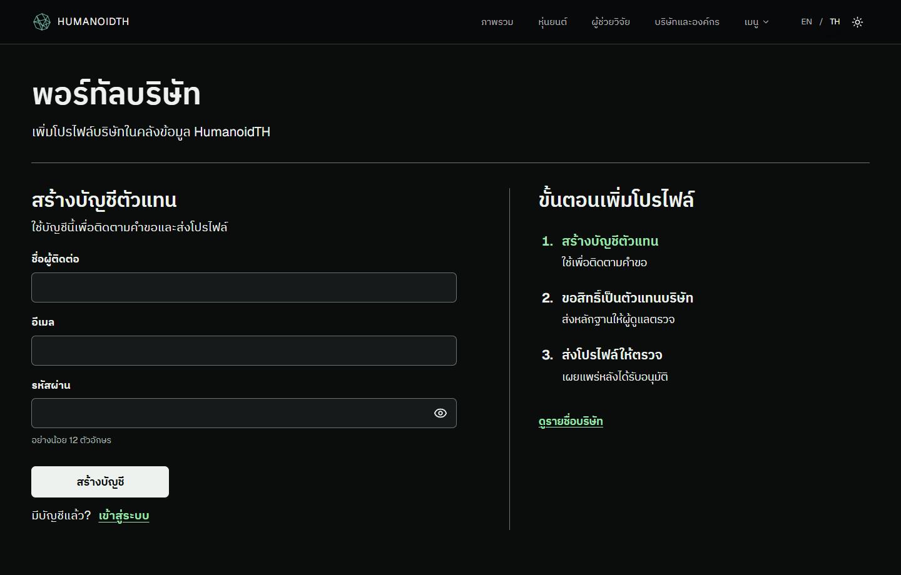

# Company Portal · แนวทางออกแบบและเดโม

ตัวแทนบริษัทต้องรู้ว่าจะขอสิทธิ์และส่งข้อมูลอย่างไร ผู้ดูแลต้องตามกลับไปถึงหลักฐานได้ และคนดูต้องเข้าใจว่าข้อมูลใดเป็นรายงานจากบริษัท เราจึงแสดงขั้นตอนตั้งแต่หน้าแรก แยกการตรวจสิทธิ์จากการอนุมัติโปรไฟล์ และวางลิงก์อ้างอิงไว้ข้างความสามารถแต่ละข้อ

## Mood Board และ CI

ภาพรวมใช้พื้นเรียบ เส้นแบ่งบาง หัวข้อชัด และเขียวเข้มสำหรับลิงก์กับสถานะ สีและจังหวะการจัดวางอ้างอิงจากทะเบียน HumanoidTH ใช้โลโก้เส้นและชื่อ HUMANOIDTH ชุดเดียวกับเมนูหลัก

| องค์ประกอบ | วิธีใช้ |
|---|---|
| สี | พื้นสว่าง `#FFFFFF` ข้อความ `#171A19` ลิงก์ `#294536` พื้นมืด `#0A0D0C` ข้อความ `#EDF2EE` ลิงก์พอร์ทัล `#9BE6AB` |
| ฟอนต์ | Geist สำหรับอังกฤษ และ IBM Plex Sans Thai สำหรับไทย หัวข้อใช้ขนาดและน้ำหนักช่วยแยกลำดับการอ่าน |
| โครงหน้า | จอกว้างวางฟอร์มคู่กับขั้นตอน จอแคบวางขั้นตอนไว้ใต้ฟอร์ม ระยะห่างช่องกรอก 18 px และช่องกรอกสูงอย่างน้อย 48 px |
| สถานะฟอร์ม | แสดงข้อความข้างช่องที่กรอกผิด ใช้ทั้งข้อความและสี เชื่อมข้อความกับช่องกรอก และย้ายโฟกัสไปยังช่องแรกที่ต้องแก้ |

[ภาพหน้าสมัครภาษาอังกฤษบนมือถือ โหมดสว่าง](./company-portal-en.png)

## เดโมสำหรับกรรมการ

1. เตรียมบัญชีตัวแทนและแอดมินในสภาพแวดล้อมทดสอบ เลือกหุ่นยนต์หนึ่งรุ่นที่มีเอกสารต้นทางและได้รับอนุญาตให้ใช้ข้อมูล ระบุแหล่งอ้างอิงของแต่ละความสามารถ
2. เปิด `/company` ขอสิทธิ์ตัวแทน แล้วให้แอดมินตรวจคำขอใน `/company-review` หลังอนุมัติสิทธิ์ ให้ตัวแทนส่งโปรไฟล์บริษัทและโปรไฟล์หุ่นยนต์ให้ตรวจ
3. ตรวจว่าโปรไฟล์ยังไม่ขึ้นในทะเบียนก่อนอนุมัติ จากนั้นอนุมัติและเปิดหน้าโปรไฟล์หุ่นยนต์ กดเปิดหลักฐานจากรายการความสามารถหนึ่งข้อ แล้วชี้ให้เห็นป้าย “บริษัทรายงาน”
4. ให้ผู้ชมตอบว่าข้อความไหนมาจากผู้ผลิต เปิดหลักฐานได้จากตรงไหน และยังต้องตรวจอะไรเพิ่มก่อนใช้ในงานที่ต้องปฏิสัมพันธ์กับคน

## หลักฐานการทดสอบ

ตรวจบน localhost แล้วทั้งหน้าไทยบนเดสก์ท็อปและหน้าอังกฤษบนมือถือ ครอบคลุมการกรอกไม่ครบ โฟกัสช่องแรก การเปิดรหัสผ่านด้วยคีย์บอร์ด การสลับสมัครกับเข้าสู่ระบบ และข้อผิดพลาดอีเมลซ้ำจากคำตอบจำลอง

สำหรับรอบทดลองกับคน ให้ตัวแทนส่งข้อเสนอ ให้ผู้ดูแลตรวจ และให้ผู้ค้นหาเปิดหลักฐานจากหน้าโปรไฟล์ เก็บเวลาที่ใช้ จำนวนครั้งที่ต้องขอความช่วยเหลือ และคำตอบต่อข้อ 4 จากนั้นตรวจเส้นทางเดียวกันด้วยโปรแกรมอ่านหน้าจอและซูม 200% ผลสองส่วนนี้ยังรอเก็บข้อมูล
